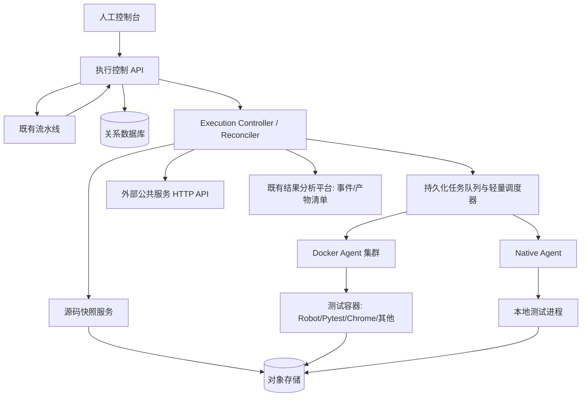

# 自动化执行平台需求与详细设计（V1.0 草案）

> 状态：架构讨论汇总，供评审及 Codex 分阶段实现。日期：2026-11-20。  
> 原则：复用既有流水线、部署、分析和公共服务；以可靠执行为核心；优先降低接入与运维成本。

## 1. 背景与目标

面向智能物联网软件平台的自动化测试，已有 Robot Framework、Pytest、JMeter、GTest、自研框架等工程，代码位于 Git/SVN；测试需要动态部署环境参数、网络访问、偶发 SSH、Chrome 浏览器和部分专用执行机。执行时长通常数小时，最长约两天；常态并发约 50，峰值不超过 200；计划部署 10～30 台专用 Docker Host。

**目标**：提供人工和流水线统一调用的自动化项目执行服务，完成源码版本固化、参数解析、运行资源调度、容器/原生进程执行、公共服务调用、状态追踪、取消、日志与原始产物交付。

**明确不做**：多工程 DAG 编排、环境部署系统、测试结果深度分析、测试环境/IoT 设备/账号互斥管理、独立浏览器管理与 Selenium Grid、自动扩缩容、任务抢占、运行中容器跨节点迁移、测试执行中途断点续跑。上述能力由现有系统、测试人员或未来项目负责。

## 2. 确认约束与待定项

| 事项 | 决策 |
|---|---|
| 节点规模 | 10～30 台专用 Linux Docker Host；少量特殊 Windows/Linux 执行机 |
| 并发与时长 | 常态约 50、峰值 ≤200；单任务最长约 48 小时 |
| 执行生命周期 | 单工程内部线性步骤；外部流水线处理跨工程依赖 |
| 运行方式 | Docker 优先，Native Agent 兼容特殊机器 |
| 浏览器 | 通常一个任务一个 Chrome；版本无严格要求；随镜像提供，默认 Headless |
| 网络与 SSH | 主要网络访问被测平台，偶发 SSH；不必将测试固定到目标服务器 |
| 源码 | 运行时按 Git commit/SVN revision 获取，形成不可变快照；不烘焙进镜像 |
| 公共服务 | 外部团队 HTTP API；支持执行前、执行后和伴随运行的服务 |
| 报告 | 执行平台保留原始日志/产物，既有分析平台负责解析与分析 |
| 重试 | 执行前临时失败可有限重试；测试开始后默认不自动重试 |
| 外部资源互斥 | 测试人员自行保证，平台不实现锁或预约 |
| 资源调度 | 第一阶段 Docker + Agent + 轻量调度器；预留更换后端接口 |

**开发前需确认**：数据库与对象存储是否有现成设施；身份认证/授权接入方式；前端技术栈；镜像仓库与镜像构建服务；代码仓库访问凭据方案；公共服务回调规范；执行入口是否普遍为单命令、是否存在前置初始化脚本；Agent 与控制服务的网络方向。

## 3. 系统边界与总体架构



**控制层**：认证、项目/配置管理、参数校验、执行状态机、任务队列、资源预留、服务生命周期、故障对账、API/回调。  
**执行层**：Docker Agent 通过本机 Docker Engine 管理容器；Native Agent 管理本地进程。Agent 只处理执行指令，不编排业务流程。  
**存储层**：数据库保存任务元数据、状态、资源预留和审计；对象存储保存源码快照、日志及报告。  
**外部系统**：流水线负责部署和跨工程编排；分析平台消费产物；公共服务由其他团队提供。

## 4. 逻辑模块

1. **Project/Execution Profile**：代码仓库引用、框架类型、镜像、启动命令、参数 Schema、资源请求、产物目录、公共服务绑定。
2. **Source Manager**：解析 Git commit 或 SVN revision；按精确版本获取代码；打包、计算 SHA256、上传对象存储；任务记录固定快照 ID。
3. **Runtime/Image Manager**：维护少量标准镜像（基础 Python/Robot、Chrome 镜像）和用户自定义 Dockerfile 构建产物；构建与执行分离；保存镜像 Digest。
4. **Parameter Resolver**：执行请求 > 保存预设 > Profile 默认值；类型校验；将变量映射到 argv/env/模板文件；敏感值使用凭据引用。
5. **Scheduler**：持久化队列、项目并发限制、CPU/内存预留、节点能力/网络标签过滤、原子分配、节点维护状态。
6. **JobExecutor**：统一 submit/status/cancel/collect 接口；Docker 与 Native 两个实现。
7. **Public Service Adapter**：调用外部 HTTP API；支持同步调用、异步任务轮询/回调、启动-停止型服务；失败和清理策略可配置。
8. **Execution/Artifact Service**：持久化状态机、Agent 心跳与对账、日志流、产物清单、回调和结果交付。

## 5. 数据模型（建议）

- `project(id, name, source_type, repository_ref, owner, status)`
- `execution_profile(id, project_id, revision, runtime_image_ref, command_template, parameter_schema, resource_spec, artifact_spec, service_bindings, enabled)`
- `execution(id, project_id, profile_revision, request_id, source_revision, snapshot_id, image_digest, context_json, status, outcome, created_at, started_at, ended_at, cancel_requested_at, pipeline_run_ref)`
- `execution_attempt(id, execution_id, attempt_no, node_id, runtime_id, status, start_confirmed_at, exit_code, failure_reason, created_at, ended_at)`
- `worker_node(id, agent_id, type, labels, cpu_total, memory_total, cpu_reserved, memory_reserved, heartbeat_at, maintenance_state)`
- `resource_reservation(id, attempt_id, node_id, cpu, memory, state, created_at, released_at)`
- `artifact(id, execution_id, attempt_id, path, storage_uri, sha256, size, content_type)`
- `service_invocation(id, execution_id, service_ref, phase, external_task_id, status, request_ref, response_ref, started_at, ended_at)`
- `execution_event(id, execution_id, attempt_id, event_type, payload, created_at)`
- `callback_delivery(id, execution_id, target_ref, event_type, attempt_count, next_retry_at, state)`

数据库对 `(caller_scope, request_id)` 建唯一约束，实现提交幂等。对状态更新采用版本号/CAS；资源预留与任务领取必须在事务中原子完成。敏感凭据不进入 `context_json`、日志或事件负载。

## 6. Execution Profile 与运行上下文

示例：

```yaml
project: robot-web-smoke
source:
  type: git
  repository_ref: web-tests
runtime:
  image: test-browser:stable
execution:
  argv:
    - robot
    - --variable
    - BASE_URL:${environment.base_url}
    - --outputdir
    - ${runtime.artifacts_dir}
    - tests/
parameters:
  environment:
    base_url: {type: string, required: true}
resources:
  cpu: 2
  memory_mb: 4096
  shm_mb: 1024
  required_labels: [web-test]
artifacts:
  directory: ${runtime.artifacts_dir}
  report_type: robot
```

- `argv` 必须为数组，不直接拼接用户输入的 shell 字符串；确需 shell 的遗留工程需显式受控配置。
- 浏览器不设独立 Browser Profile；镜像内部维护 Chrome/ChromeDriver 或 Playwright 兼容关系。
- 对 `pybot`、特殊驱动或不同框架，允许自定义镜像和命令；不要求修改现有测试代码。
- 运行时生成不可变 `execution-context.json`，至少包含 `environment`、`test`、`runtime`，并转换为遗留工程支持的命令行参数、环境变量或配置文件。
- 环境信息由人工填写或流水线传入，二者进入同一参数校验链路。

## 7. 执行生命周期与状态

业务 `Execution`：`QUEUED → PREPARING → STARTING → RUNNING → FINALIZING → COMPLETED / FAILED / CANCELLED`；取消时进入 `CANCELLING`；无法确认节点状态时进入 `RECONCILING`，不直接重试。

物理 `Attempt`：`CREATED → STARTING → RUNNING → EXITED / LOST / CANCELLED`。每次物理启动对应独立 Attempt，Execution 可能包含多个 Attempt，但第一阶段默认不重试已开始的测试。

区分：
- `execution.status`：平台运行生命周期是否结束。
- `execution.outcome`：`UNKNOWN / PASSED / FAILED / NOT_EVALUATED`，可由轻量适配或分析平台提供；不要把 Robot 用例失败等同于基础设施故障。
- `failure_reason`：如 `SOURCE_FETCH_FAILED`、`IMAGE_PULL_FAILED`、`NODE_LOST`、`PROCESS_EXIT_NONZERO`、`ARTIFACT_UPLOAD_FAILED`。

线性执行步骤：接收请求 → 参数校验 → 源码快照 → 公共服务前置调用 → 资源预留 → 启动任务 → 伴随服务监测 → 停止/结束 → 清理公共服务 → 上传产物 → 最终状态及通知。清理必须在异常和取消路径中尽最大努力执行；清理失败单独记录。

## 8. 调度与 Agent 协议

**调度**：数据库持久化 FIFO 队列，支持项目最大并发；过滤节点在线状态、维护状态、网络标签、CPU/内存可用资源；再按剩余容量或负载选择节点。调度器使用事务领取任务与预留资源，防止并发重复分配。第一阶段不做外部测试环境互斥、抢占、自动扩缩容。

**Agent 接口（逻辑协议）**：
- `register`：agent_id、节点能力、总资源、版本。
- `heartbeat`：节点健康、资源指标、运行 Attempt 清单。
- `start(attempt_id, immutable_spec)`：幂等启动，返回 runtime_id；重复请求必须返回原实例，不得新建。
- `inspect(attempt_id/runtime_id)`：返回真实运行状态、退出码、时间戳。
- `cancel(attempt_id)`：幂等停止；优雅终止后超时强制结束整个容器/进程组。
- `collect(attempt_id)`：产物上传状态和清单。

Agent 在本机持久化运行标识，并为 Docker 容器打 `execution_id`、`attempt_id` 标签。控制服务或 Agent 重启后，通过本地 Docker 查询恢复映射。Agent 到平台采用认证的 TLS 通道；避免开放无保护 Docker Remote API。具体使用轮询还是长连接待网络拓扑确认。

## 9. 故障恢复与幂等性

| 场景 | 行为 |
|---|---|
| API/控制服务重启 | 容器继续运行；服务恢复后读取 DB 并对账 |
| Agent 重启 | 原容器尽量继续运行；Agent 查询 Docker 标签恢复任务映射 |
| 控制服务与节点网络分区 | 标记 RECONCILING；不因心跳超时重复启动 |
| Docker Host 整机故障 | 确认原任务丢失后标记 LOST/FAILED；不自动重跑已开始测试 |
| 提交启动请求超时 | 按 attempt_id 查询或重发幂等 start；禁止盲目创建第二实例 |
| 测试进程非零退出 | 保留退出码、日志和原始报告；由策略/分析平台判断测试结论 |
| 用户取消 | CANCELLING → 确认进程停止 → 清理/产物上传 → CANCELLED |
| 产物上传失败 | 独立重试与失败标记，不丢失执行元数据 |

对账器定期比较数据库与 Agent/Docker 的真实状态。终态不可随意回退；对账应处理迟到事件、重复事件和网络超时。回调采用持久化 outbox、至少一次投递，接收方按事件 ID 去重。

## 10. 公共服务集成

公共服务由其他团队提供 HTTP API。平台存储服务注册信息、请求参数 Schema、认证方式引用、调用超时、异步任务状态映射和清理方法。支持：
- `before`：测试前一次性执行；失败按配置阻止启动。
- `during`：启动监测/采集服务并持续运行，结束时停止。
- `after`：测试结束后执行。

仅编排**单次 Execution 内的线性步骤与伴随服务**，不承担跨工程工作流。对外部 API 调用重试应考虑幂等键，尤其是创建型服务；清理动作尽可能幂等。

## 11. API 设计（第一阶段）

| 方法 | 路径 | 用途 |
|---|---|---|
| POST | `/api/v1/executions` | 提交执行，支持 `Idempotency-Key` |
| GET | `/api/v1/executions/{id}` | 状态、时间、节点、结果摘要 |
| POST | `/api/v1/executions/{id}/cancel` | 异步请求取消 |
| GET | `/api/v1/executions/{id}/events` | 状态变更事件 |
| GET | `/api/v1/executions/{id}/logs` | 分页/流式读取日志 |
| GET | `/api/v1/executions/{id}/artifacts` | 原始产物清单及授权下载链接 |
| GET | `/api/v1/projects` | 查询项目 |
| GET | `/api/v1/projects/{id}/profiles` | 查询可执行配置 |
| POST | `/api/v1/projects` | 注册项目 |
| POST | `/api/v1/projects/{id}/profiles` | 创建配置版本 |
| GET | `/api/v1/nodes` | 节点状态和资源 |

提交请求示例：

```json
{
  "project_id": "robot-web-smoke",
  "profile_id": "default",
  "parameters": {"environment": {"base_url": "https://test.example.invalid"}},
  "source_revision": "main",
  "caller": {"type": "pipeline", "run_ref": "pipeline-123"},
  "callback_ref": "pipeline-default"
}
```

注意：`main` 在提交时必须解析为具体 commit，并在任务中固化。响应应立即返回 `execution_id` 和 `QUEUED` 状态，不等待测试结束。回调目标需预注册或进行严格白名单验证，避免 SSRF。

## 12. 日志、产物与分析平台交接

约定容器挂载 `/workspace`（源码）、`/artifacts`（报告）、必要的只读上下文文件；将 stdout/stderr 作为平台日志，框架原始文件统一上传对象存储。产物清单包含路径、大小、哈希、类型、存储引用。执行结束后发布 `execution.finalized` 事件或调用分析平台的既有接口；分析平台负责用例级解析、趋势、质量评估。日志支持在线查看、脱敏、访问控制、保留策略和大小上限。

## 13. 安全与非功能要求

- 平台 API 认证授权，项目级权限、运行配额和审计；人工与流水线凭据隔离。
- Agent 双向认证或等效强认证；不暴露未保护 Docker API。
- 自定义 Dockerfile 在隔离构建环境中构建、扫描、发布；执行容器默认非特权，限制挂载、Linux capabilities 和外联网络。
- SSH 凭据使用秘密管理服务引用，运行时按需注入，不进入镜像、配置库、日志或报告。
- Chrome 默认 Headless；合理配置 `/dev/shm`、CPU/内存；不默认启用 `--privileged` 或关闭沙箱。
- 持久化任务状态、资源预留、取消和对账；单控制服务重启不影响已运行任务。
- 峰值 200 并发需要压测验证；资源规格必须以真实 Chrome/Robot 工作负载测量为准，不预设固定节点容量。
- 节点维护：停止接收新任务，现有长任务可等待结束；支持查看仍在运行的任务。
- 任务最长 48 小时的超时策略应可配置，避免因控制端 HTTP 超时影响运行。

## 14. 建议实现技术（非既定）

- 控制服务：Python 3 + FastAPI；持久化：优先复用现有 PostgreSQL/MySQL；任务队列第一阶段可用数据库事务实现。
- Agent：Python 服务，Docker SDK 或本机受控 Docker CLI；Native Agent 通过进程组管理。
- 对象存储：复用现有 S3 兼容服务或 MinIO；镜像仓库：复用现有 Registry/Harbor。
- 前端：按现有团队技术栈确定，不在此阶段强制选择。
- 源码：Git CLI、SVN CLI，单独 Source Worker；构建：复用现有镜像构建能力，必要时使用 BuildKit。
- 将 `JobExecutor` 抽象为窄接口，未来可替换 Nomad/Kubernetes 后端，但不提前开发复杂插件市场。

## 15. 分阶段开发任务（给 Codex）

### M0：代码仓库与接口契约
- 建立 `control-plane/`、`agent/`、`shared/`、`web/`（可选）、`docs/`、`tests/` 目录。
- 定义 Execution/Profile/Attempt/Agent 协议、OpenAPI、状态机和数据库迁移。
- 交付：可运行骨架、契约测试、Docker Compose 本地开发环境。

### M1：最小端到端执行闭环
- 项目与 Profile CRUD、提交/查询、数据库队列、单节点 Agent 启动 Docker、日志采集、产物上传。
- 用 Robot + Headless Chrome 演示一次完整执行；同时演示普通 Python 任务。
- 验收：提交后异步返回；精确记录镜像/源码版本；任务完成后可下载原始报告。

### M2：多节点调度与可靠性
- 节点注册/心跳、CPU/内存预留、标签过滤、项目并发限制、取消、Agent 重启恢复、控制服务重启对账。
- 验收：重复提交/启动不重复执行；断网期间不盲目重跑；节点维护时不接新任务。

### M3：工程接入与公共服务
- Git/SVN 源码快照、执行参数映射、配置预设、公共 HTTP 服务 before/during/after、Native Agent。
- 验收：已有 Robot 工程无需改动主体代码即可接入；支持 SSH 访问远程服务器；公共服务清理可追踪。

### M4：流水线集成、运维与压测
- API 认证授权、回调/outbox、分析平台产物通知、镜像构建接入、审计、监控告警。
- 验收：10/30/50 并发逐级压测；基于实测数据规划 200 并发；长任务、控制服务重启、Agent 重启、Host 故障、取消和产物上传失败的故障注入测试通过。

## 16. Codex 工作约束

1. **先阅读本文档，输出实现计划与待确认问题，不要直接实现所有模块。**
2. 按 M0→M4 分阶段提交；每阶段需包含代码、迁移、配置示例、测试和 README。
3. 不擅自引入 K8s/Nomad、Selenium Grid、复杂工作流、资源互斥、报告分析等已明确排除能力。
4. 先做可运行的最小闭环，再做多节点与异常恢复；禁止以 Mock 成功代替真实 Docker 端到端验证。
5. 关键路径需有自动化测试：幂等提交、并发调度、资源预留、Agent 重启、状态对账、取消、日志和产物交付。
6. 对未确认的技术选型列出选项和影响，不擅自将建议方案视为硬约束。
7. 每次提交提供变更摘要、验证命令、测试结果和已知限制。

## 17. Codex 首轮指令（可直接复制）

```text
请以仓库中的 docs/automation_execution_platform_design_v1.md 为需求与架构基线。
先不要一次性实现整个系统。请完成以下工作：
1. 阅读文档，列出已确认的约束、待确认决策和风险，不得自行扩大范围。
2. 提供技术实现方案（模块划分、数据库表结构、API 契约、Agent 协议、状态机、目录结构）。
3. 将 M0～M4 拆解为可独立验收的小任务，标明依赖、交付物、自动化测试和验收标准。
4. 优先实现 M0：项目骨架、数据模型迁移、OpenAPI 草案、执行状态机和契约测试。
5. 在进入 M1 前提交方案供评审，不要擅自实现排除范围内的能力。
6. 每个任务必须提供可复现的运行/测试命令和实际验证证据。
请特别关注：执行提交幂等、资源预留原子性、网络分区不重复执行、运行中的容器不依赖控制服务在线、任务取消后的产物收集。
```

## 18. 评审清单

- [ ] 现有工程是否均可用单命令启动？多步骤初始化如何描述？
- [ ] 已有 MySQL/PostgreSQL、对象存储、镜像仓库、构建服务分别是什么？
- [ ] Agent 网络拓扑和认证方式是否确定？
- [ ] 公共服务 API 的异步协议和清理协议是否明确？
- [ ] 人工界面技术栈和权限系统是否确定？
- [ ] 是否有代表性 Robot+Chrome、Playwright、Pytest、JMeter、GTest 工程用于验收？
- [ ] 执行结果分析平台如何接收事件与产物引用？
- [ ] 节点资源规格、网络区域标签和初期 PoC 机器数量是否确定？
