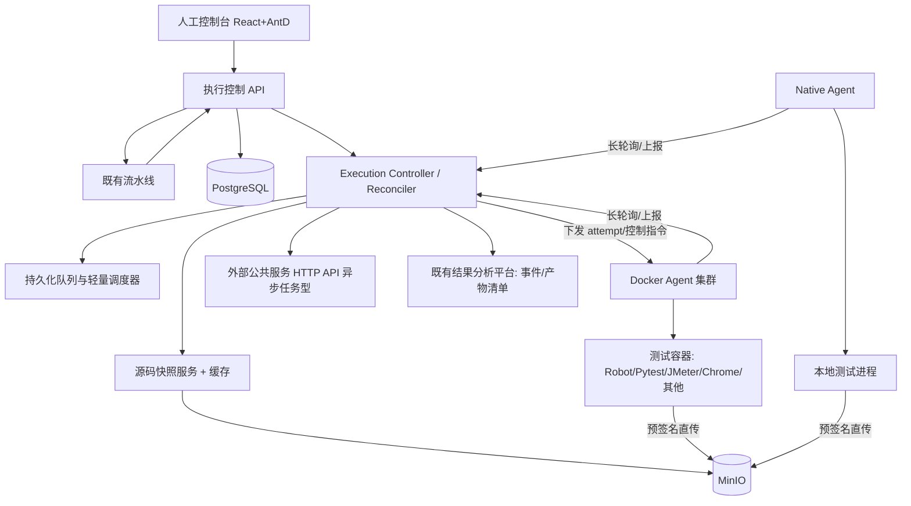

# 自动化执行平台需求与详细设计（V2.1）

> 状态：V1.0 评审修订 + 业务功能需求补充版，作为实现基线。日期：2026-11-19。
> 原则不变：复用既有设施；以可靠执行为核心；优先降低接入与运维成本。
> V1.0 原文见 `automation_execution_platform_design_v1.md`（仅存档，不再维护）。

## 0. V1 → V2 变更摘要

| # | 变更 | 原因 |
|---|---|---|
| 1 | 执行步骤重排：排队期异步预取快照；**资源预留成功后才调 before 服务并立即启动** | 原顺序下任务可能做完外部服务调用后排队数小时，外部资源空占或过期 |
| 2 | 日志链路落地：Agent 本地落盘 + 切片增量上传对象存储，API 从对象存储读 | 48h 任务日志不因控制面重启/分区丢失；运行中可查看 |
| 3 | RECONCILING 定义收敛出口：确认窗口 + 管理端标记 LOST | 原设计只有入口没有出口，任务可能永久卡死 |
| 4 | 超时由 Agent 本地看门狗执行（死线随 spec 下发并持久化），控制面兜底 | 控制面分区时 48h 超时仍可执行 |
| 5 | API 补执行列表接口；提交支持可选 `priority` | 控制台必需；多部门争抢资源时需要优先级 |
| 6 | Agent 通信定为 **Agent 主动长轮询** | 已确认执行机可出站访问控制面；消除待定项，NAT 友好 |
| 7 | 源码快照按 (repo, 精确版本) 内容寻址缓存；shallow/sparse 拉取 | 防高峰期快照服务成为瓶颈 |
| 8 | `image_digest` 下沉到 attempt 级；支持 per-request 超时覆盖 | 重试换镜像场景的精确审计 |
| 9 | `failure_reason` 细化容器级死因（如 `CONTAINER_OOM_KILLED`） | 区分资源规格问题与测试失败 |
| 10 | during 服务中途失败行为按绑定配置化；清理在任何结束路径必执行 | 原语义未定义 |
| 11 | 产物/日志上传使用 attempt 级临时凭据（预签名） | 缩小节点凭据暴露面 |
| 12 | 维护模式支持限期排水（deadline + 可选强制下线） | 48h 任务可能把维护卡住两天 |
| 13 | 敏感值仅经 env 注入（不进 argv）；`execution-context.json` 排除出产物收集 | 防 `ps` 泄漏与误上传 |
| 14 | 多部门支持：部门并发配额、部门间公平排队、项目按部门隔离 | 确认：不同部门同事同时使用 |
| 15 | 技术选型确定：PostgreSQL / MinIO / FastAPI + Python / React+TS+Vite+AntD | 评审确认 |
| 16 | Profile 增加可选 `prepare` 步骤（装依赖类工程免改代码接入） | 确认：部分工程需运行前装依赖，无需编译 |
| 17 | Git 与 SVN 同期支持（M3 一起交付） | 评审确认 |
| 18 | 公共服务按**异步任务型**为主设计（task_id + 轮询；同步与回调模式也支持） | 确认：外部服务存在异步任务型 |
| 19 | 新增**业务功能模块**章节（§1.1）：配置侧（执行机/镜像、工程、服务目录）+ 应用侧（环境准备、执行、结果采集） | 业务需求评审补充 |
| 20 | **执行机自助注册**：控制台生成安装命令 + 一次性令牌，自动探测 Docker/Native 模式 | 支持测试同事自建执行机 |
| 21 | **镜像库**：平台公共镜像 + 自定义镜像引用现成地址（M1 起）+ Dockerfile 构建（M4） | 确认：两种方式都要 |
| 22 | 公共服务统一为**服务目录**：预制条目（服务器日志检查、精准测试初始化）+ 第三方注册；功能后端均为 HTTP API，平台不内置业务逻辑 | 确认：预制服务也以公共服务形态实现 |
| 23 | **执行环境选择**：Profile 定默认（平台 Docker / 自建机），提交时可覆盖 | 应用侧环境准备需求 |
| 24 | **轻量结果摘要**：内置解析 Robot/Pytest/JMeter/GTest 报告，控制台展示通过率与失败清单；深度分析仍归分析平台 | 确认：内置轻量摘要 |

## 1. 背景与目标

面向智能物联网软件平台的自动化测试，已有 Robot Framework、Pytest、JMeter、GTest、自研框架等工程，代码位于 Git/SVN；测试需要动态部署环境参数、网络访问、偶发 SSH、Chrome 浏览器和部分专用执行机。执行时长通常数小时，最长约两天；常态并发约 50，峰值不超过 200；计划部署 10～30 台专用 Docker Host。**平台由不同部门同时使用**，需要部门间资源公平与隔离。

**目标**：提供人工和流水线统一调用的自动化项目执行服务，完成源码版本固化、参数解析、运行资源调度、容器/原生进程执行、公共服务调用、状态追踪、取消、日志与原始产物交付。

**明确不做**：多工程 DAG 编排、环境部署系统、测试结果深度分析、测试环境/IoT 设备/账号互斥管理、独立浏览器管理与 Selenium Grid、自动扩缩容、任务抢占、运行中容器跨节点迁移、测试执行中途断点续跑。上述能力由现有系统、测试人员或未来项目负责。

### 1.1 业务功能模块（V2.1 新增）

**配置侧（管理态）**：

| 模块 | 内容 | 对应设计 |
|---|---|---|
| 执行机管理 | 平台 Docker 主机 + 测试同事自建机**自助注册**（控制台生成安装命令与令牌，首启自动探测 Docker/Native 模式，自声明资源与标签）；维护状态管理 | §4.9、§5、§8 |
| 镜像管理 | 平台维护公共镜像库（Python/Robot/Chrome/JMeter 等）；自定义镜像：**引用现成地址即用**（M1 起），Dockerfile 隔离构建（M4） | §4.10、§5 `runtime_image` |
| 自动化工程管理 | 测试同事自服务维护工程：仓库、镜像、prepare、执行命令与参数（标准 YAML 格式，§6）、资源、产物、服务绑定 | §6 Project/Profile |
| 公共服务配置 | 统一**服务目录**：预制条目（服务器日志检查、精准测试初始化）+ 第三方注册扩展；参数 Schema、可见范围、绑定 | §10、§5 `service_catalog` |

**应用侧（运行态）**：

| 模块 | 内容 | 对应设计 |
|---|---|---|
| 执行环境准备 | 选平台 Docker 快速拉起，或跑在自己注册的执行机上（Profile 默认 + 提交时覆盖） | §6 `placement`、§8 |
| 公共服务 + 工程执行 | before/during/after 服务调用与测试执行的线性生命周期 | §7 |
| 结果采集 | 日志增量上传、原始产物收集、**轻量结果摘要**（通过率/失败清单）；深度分析归分析平台 | §12 |

> 预制服务说明：服务器日志检查、精准测试初始化（调现有精准测试系统 API）均为服务目录预制条目，功能后端由服务提供方以 HTTP API 交付；平台核心只做登记、编排调用与状态追踪，不内置具体业务逻辑。

## 2. 已确认决策与遗留待定项

| 事项 | 决策 |
|---|---|
| 数据库 | **PostgreSQL**（JSONB、`FOR UPDATE SKIP LOCKED` 队列、Alembic 迁移） |
| 对象存储 | **MinIO**（S3 兼容，预签名上传/下载） |
| 节点规模 | 10～30 台专用 Linux Docker Host；少量特殊 Windows/Linux 执行机（Native Agent） |
| 并发与时长 | 常态约 50、峰值 ≤200；单任务最长约 48 小时（可按任务覆盖） |
| 执行生命周期 | 单工程内部线性步骤；外部流水线处理跨工程依赖 |
| 运行方式 | Docker 优先；`prepare` 步骤覆盖装依赖类工程；长期建议依赖烘进镜像提速 |
| 执行环境选择 | Profile 定默认（平台 Docker / 自建机），提交时可覆盖 |
| 自定义镜像 | 引用现成地址即用（M1 起）+ Dockerfile 构建（M4） |
| 预制公共服务 | **延后接入**：先提供管理员配置界面；日志检查/精准测试初始化待接口规范就绪后登记 |
| 浏览器 | 一个任务一个 Chrome；随镜像提供，默认 Headless |
| 网络与 SSH | 主要访问被测平台，偶发 SSH；不固定测试到目标服务器 |
| 源码 | 运行时按 Git commit / SVN revision 获取，不可变快照 + 缓存；不烘焙进镜像 |
| 源码类型 | **Git 与 SVN 同期支持** |
| 公共服务 | 外部团队 HTTP API，**异步任务型为主**（详见 §10）；支持 before/during/after |
| 报告 | 平台保留原始日志/产物，既有分析平台负责解析 |
| 重试 | 执行前临时失败可有限重试；测试开始后默认不自动重试 |
| 外部资源互斥 | 测试人员自行保证 |
| 资源调度 | 自研轻量调度器（DB 队列）；`JobExecutor` 抽象预留后端替换 |
| Agent 通信 | **Agent 主动长轮询**（已确认执行机可出站访问控制面），mTLS |
| 多部门 | 部门并发配额；部门间公平排队；项目按部门隔离权限 |
| 前端 | **React + TypeScript + Vite + Ant Design** 中后台；M1 最小版，M4 完善 |

**遗留待定项**（不阻塞 M0/M1，进入对应里程碑前确认）：

| 事项 | 需要时点 |
|---|---|
| 公司 SSO/LDAP 接入方式与凭据签发 | M4 认证授权前 |
| 镜像仓库与构建服务现状（复用 Harbor？） | M1 镜像管理前 |
| 代码仓库访问凭据托管方案（有无现成秘密管理） | M3 Source Manager 前 |
| 公共服务各接口规范（含日志检查、精准测试初始化后端的提供方与规范） | M3 前 |
| 代表性验收工程清单（Robot+Chrome / Pytest / JMeter / GTest / SVN 各一） | M1/M3 验收前 |

## 3. 系统边界与总体架构



**控制层**：认证、项目/配置管理、参数校验、执行状态机、任务队列与公平调度、资源预留、服务生命周期、故障对账、API/回调。
**执行层**：Agent 通过本机 Docker Engine / 进程组管理执行物；只处理执行指令，不编排业务。**所有连接由 Agent 发起**（长轮询取任务 + 上报状态/日志清单）。
**存储层**：PostgreSQL 存元数据/状态/预留/审计；MinIO 存快照、日志分片与产物。
**外部系统**：流水线负责部署与跨工程编排；分析平台消费产物；公共服务由其他团队提供。

## 4. 逻辑模块

1. **Project/Execution Profile**：代码仓库引用、框架类型、镜像、prepare 步骤、启动命令、参数 Schema、资源请求、产物目录、公共服务绑定、部门归属。
2. **Source Manager**：解析 Git commit / SVN revision 为精确版本；按 (repo, version) 缓存快照（未命中时 shallow/sparse 拉取）；打包、SHA256、上传 MinIO；持有代码仓库凭据（独立凭据边界，不出日志）。
3. **Runtime/Image Manager**：少量标准镜像（Python/Robot、Chrome）+ 用户自定义 Dockerfile 构建产物；构建与执行分离；Digest 固化在 attempt。
4. **Parameter Resolver**：执行请求 > 预设 > Profile 默认；类型校验；映射到 argv/env/模板文件；**敏感值只走 env**，凭据引用在启动时经 mTLS 通道解析注入，不落 Agent 磁盘。
5. **Scheduler**：持久化队列、部门公平轮询 + 部门并发配额 + 项目并发限制、可选 priority、CPU/内存预留、节点能力/网络标签过滤、事务内原子分配（`SKIP LOCKED`）、节点维护状态。
6. **JobExecutor**：统一 submit/status/cancel/collect 窄接口；Docker 与 Native 两实现；预留后端替换。
7. **Public Service Adapter**：见 §10。
8. **Execution/Artifact Service**：状态机、心跳对账、日志分片清单、产物清单、outbox 回调、结果交付。
9. **Node Enrollment（V2.1）**：控制台生成安装命令与一次性令牌；Agent 首启注册，自动探测 Docker 可用性决定 Docker/Native 模式；自声明资源与标签；纳入心跳与维护管理。
10. **Image Library（V2.1）**：公共镜像维护；自定义镜像登记（引用现成地址即用，M1）；Dockerfile 隔离构建、扫描、发布（M4）；Digest 固化。
11. **Service Catalog（V2.1）**：预制与第三方服务的统一目录、参数 Schema、可见范围、绑定管理；平台不实现服务业务逻辑。
12. **Result Summarizer（V2.1）**：按 `report_type` 解析常见报告格式（Robot/Pytest/JMeter/GTest），产出通过率与失败清单，供控制台展示与事件携带；解析失败不影响产物交付。

## 5. 数据模型（修订）

- `department(id, name, max_concurrent, last_scheduled_at)` — 配额与公平排队依据
- `project(id, name, department_id, source_type, repository_ref, owner, status)`
- `execution_profile(id, project_id, revision, runtime_image_ref, prepare_spec, command_template, parameter_schema, resource_spec, artifact_spec, service_bindings, timeout_default, enabled)`
- `execution(id, project_id, profile_revision, request_id, caller_scope, priority, source_revision, snapshot_id, context_json, timeout_seconds, status, outcome, created_at, started_at, ended_at, cancel_requested_at, pipeline_run_ref)` — 唯一约束 `(caller_scope, request_id)` 幂等
- `execution_attempt(id, execution_id, attempt_no, node_id, image_digest, runtime_id, spec_json, deadline_at, status, start_confirmed_at, exit_code, failure_reason, created_at, ended_at)` — `spec_json` 不可变；死线持久化供看门狗
- `worker_node(id, agent_id, type, labels, cpu_total, memory_total, cpu_reserved, memory_reserved, heartbeat_at, maintenance_state, maintenance_deadline)`
- `resource_reservation(id, attempt_id, node_id, cpu, memory, state, created_at, released_at)`
- `artifact(id, execution_id, attempt_id, path, storage_uri, sha256, size, content_type)`
- `log_manifest(attempt_id, stream, chunk_count, bytes_uploaded, finalized)` — 日志分片清单
- `service_invocation(id, execution_id, service_ref, phase, external_task_id, status, request_ref, response_ref, started_at, ended_at)`
- `execution_event(id, execution_id, attempt_id, event_type, payload, created_at)` — 索引 `(execution_id, created_at)`
- `callback_delivery(id, execution_id, target_ref, event_type, attempt_count, next_retry_at, state)`
- `node_enrollment_token(id, token_hash, department_id, created_by, expires_at, used_by_node_id)` — 自建机自助注册（V2.1）
- `runtime_image(id, name, tag, digest, source, ref_uri, dockerfile_ref, department_id, owner, visibility, status, created_at)` — source: official / reference / build（V2.1）
- `service_catalog(id, key, name, kind, mode, endpoint_ref, auth_ref, phases, params_schema, cleanup_ref, visibility, enabled)` — kind: preset / custom（V2.1）
- `execution_result(id, execution_id, attempt_id, report_type, total, passed, failed, skipped, error, duration_s, failures_json, parsed_at)` — 轻量摘要（V2.1）

约束：状态更新用版本号/CAS；预留与领取在同一事务原子完成；敏感凭据不进 `context_json`、日志、事件负载。

## 6. Execution Profile 与运行上下文

```yaml
project: robot-web-smoke
source:
  type: git            # git | svn
  repository_ref: web-tests
runtime:
  image: test-browser:stable
placement:              # 执行环境：Profile 默认，提交时可覆盖
  mode: platform_docker # platform_docker | own_node
  node_labels: []       # own_node：限定自建机标签（默认本人全部机器）
execution:
  prepare:             # 可选；装依赖类工程免改代码接入
    argv: [pip, install, -r, requirements.txt, -i, https://mirror.example/simple]
    timeout_s: 600
  argv:
    - robot
    - --variable
    - BASE_URL:${environment.base_url}
    - --outputdir
    - ${runtime.artifacts_dir}
    - tests/
  timeout_s: 172800    # 48h 上限内可调
parameters:
  environment:
    base_url: {type: string, required: true}
resources:
  cpu: 2
  memory_mb: 4096
  shm_mb: 1024
  required_labels: [web-test]
artifacts:
  directory: ${runtime.artifacts_dir}
  exclude: [execution-context.json]   # 上下文文件永不收集
  report_type: robot
```

- `argv`/`prepare.argv` 必须为数组，不拼接 shell 字符串；遗留工程确需 shell 时显式受控配置。
- 敏感参数声明为 `secret` 引用：仅以 env 注入容器，不出现在 argv（`ps` 可见）、日志与 `execution-context.json`；日志上传前对已知敏感值做掩码。
- 运行时生成不可变 `execution-context.json`（含 `environment`/`test`/`runtime` 非敏感部分），转换为命令行参数、环境变量或配置文件。
- 人工填写与流水线传入走同一参数校验链路。

## 7. 执行生命周期与状态

业务 `Execution`：`QUEUED → PREPARING → STARTING → RUNNING → FINALIZING → COMPLETED / FAILED / CANCELLED`；取消 `CANCELLING`；无法确认节点状态 `RECONCILING`。
物理 `Attempt`：`CREATED → STARTING → RUNNING → EXITED / LOST / CANCELLED`。

三字段区分（不变）：`status`（生命周期）/ `outcome`（UNKNOWN/PASSED/FAILED/NOT_EVALUATED）/ `failure_reason`。`failure_reason` 枚举扩充：`SOURCE_FETCH_FAILED`、`PREPARE_FAILED`、`IMAGE_PULL_FAILED`、`CONTAINER_OOM_KILLED`、`NODE_LOST`、`DEADLINE_EXCEEDED`、`PROCESS_EXIT_NONZERO`、`ARTIFACT_UPLOAD_FAILED`。

**线性执行步骤（V2 重排）**：

1. 接收请求（幂等键去重）→ 参数校验 → 入队 `QUEUED`
2. **排队期间**：Source Worker 异步预取快照（缓存命中则秒回）
3. 调度器预留资源（部门公平 + 配额 + 标签 + 原子领取）→ `PREPARING`
4. before 公共服务顺序调用（异步型等终态；失败按配置阻断 → `FAILED`）
5. 立即下发 Agent（幂等 start）→ `STARTING` → `RUNNING`
6. 伴随 during 服务；Agent 本地看门狗按 `deadline_at` 执法
7. 结束/超时/取消 → 停止 during 服务 → 产物与日志终态化上传 → `FINALIZING`
8. 清理（尽力而为，失败单独记录，不阻塞终态）→ 终态 + outbox 回调

取消在每一步都有检查点；`CANCELLING → 确认进程停止 → 收尾 → CANCELLED`。

**RECONCILING 收敛（V2 新增）**：心跳断开超过阈值（默认 90s）→ `RECONCILING`，不重复启动。出口有二：① Agent 重连并上报真实状态 → 恢复或转终态；② 超过确认窗口（默认 6h，可配）无重连 → 管理端 `mark-lost`（需确认令牌）→ `LOST`/`FAILED(NODE_LOST)`。看门狗死线到期会自行了结大部分分区任务，减少人工介入。

**维护排水（V2 新增）**：`ACTIVE / DRAINING(deadline?) / OFFLINE`。DRAINING 停止接新任务；设了 deadline 到期后对剩余任务执行取消+宽限强杀，操作员确认后 OFFLINE。

## 8. 调度与 Agent 协议

**调度**：PostgreSQL 持久化队列。领取事务：`SELECT ... FOR UPDATE SKIP LOCKED`，候选序 = 部门轮询（`department.last_scheduled_at` 最旧优先）→ `priority DESC` → `created_at ASC`；同事务内完成预留写入与部门时间戳更新。节点过滤：在线、非维护、标签匹配、CPU/内存可用。峰值 200 并发下该规模无需外部调度器。

**Agent 接口（Agent 发起，mTLS）**：

| 动作 | 方向 | 说明 |
|---|---|---|
| `POST /agent/v1/poll` | Agent→控制面 | 长轮询（≤30s）；返回分配的 attempt（含不可变 spec、死线、临时上传凭据）与控制指令（cancel 等） |
| `POST /agent/v1/heartbeat` | Agent→控制面 | 节点健康、资源、运行 attempt 清单（可与 poll 合并节奏） |
| `POST /agent/v1/attempts/{id}/status` | Agent→控制面 | 状态/退出码/时间戳/OOM 标志 |
| `POST /agent/v1/attempts/{id}/log-manifest` | Agent→控制面 | 日志分片清单更新 |
| `start(attempt_id, spec)` | 本地语义 | 幂等：重复请求返回原 runtime_id，不新建实例 |
| `inspect / cancel / collect` | 本地语义 | inspect 返回真实状态；cancel 幂等，优雅终止超时后强杀进程组/容器；collect 上报产物清单 |

- Agent 本地持久化 attempt 标识；Docker 容器打 `execution_id`/`attempt_id` 标签；Agent 重启后按标签恢复映射。
- **看门狗**：`deadline_at` 随 spec 下发并由 Agent 持久化；到期发 SIGTERM→宽限→SIGKILL，即使与控制面分区也执行。
- 日志/产物经 MinIO 预签名 URL 直传，凭据仅限该 attempt 前缀、短时效。
- 不开放任何入站端口到 Docker Engine；Agent 到控制面全程 mTLS。

## 9. 故障恢复与幂等性

| 场景 | 行为 |
|---|---|
| 控制服务重启 | 容器继续运行；恢复后读 DB 对账 |
| Agent 重启 | 容器尽量继续；按 Docker 标签恢复映射；本地日志文件续传未上传分片 |
| 网络分区 | RECONCILING；看门狗照常执法；不重复启动；按 §7 收敛 |
| 整机故障 | 确认窗口后管理端 mark-lost；不自动重跑已开始测试 |
| 启动请求超时 | 按 attempt_id 查询/幂等重发；禁止第二实例 |
| 非零退出 / OOM | 保留退出码与日志；`CONTAINER_OOM_KILLED` 单列，提示调整 resource_spec |
| 用户取消 | 各阶段检查点；确认停止后收尾、产物尽力收集 |
| 产物/日志上传失败 | 独立重试与失败标记；元数据不丢；本地文件保留至终态确认 |

对账器定期比对 DB 与 Agent/Docker 真实状态；终态不回退；处理迟到/重复事件。回调走持久化 outbox、至少一次、按事件 ID 去重。

## 10. 公共服务集成（异步任务型为主）

所有公共服务（含预制）统一登记于**服务目录** `service_catalog`：endpoint、认证引用、超时、**模式**（`sync` / `async_poll` / `async_callback`）、终态映射、清理方法、可见范围。服务条目由**管理员在目录中配置登记**（含第三方扩展）；服务器日志检查、精准测试初始化等预制条目待接口规范就绪后接入。平台核心只做登记、编排调用与状态追踪，不内置服务业务逻辑。主路径 `async_poll`：

```
submit → {task_id} → 按 interval 轮询 status → 终态映射(SUCCEEDED/FAILED) → 超时上限
```

- `before`：顺序调用；异步型等待终态；失败按绑定配置阻断启动。
- `during`：启动后保持；**中途失败行为按绑定配置：`fail_execution` 或 `warn`**；结束时停止。
- `after`：结束后执行；报告类尽力而为。
- 清理动作（注销/释放）在成功、失败、取消路径**一律执行**（幂等设计），失败单独记录告警。
- `async_callback` 模式由平台暴露带签名校验的回调端点，白名单对端。
- 创建型调用携带幂等键（`invocation_id`），防重试导致重复开通。

## 11. API 设计（第一阶段，V2 修订）

| 方法 | 路径 | 用途 |
|---|---|---|
| POST | `/api/v1/executions` | 提交执行，`Idempotency-Key`；支持 `priority`、`timeout_seconds` 覆盖 |
| GET | `/api/v1/executions` | **列表**：按 project/status/department/时间过滤分页 |
| GET | `/api/v1/executions/{id}` | 状态、时间、节点、结果摘要 |
| POST | `/api/v1/executions/{id}/cancel` | 异步取消 |
| GET | `/api/v1/executions/{id}/events` | 事件流 |
| GET | `/api/v1/executions/{id}/logs` | 已上传分片读取（支持 offset/尾随） |
| GET | `/api/v1/executions/{id}/artifacts` | 产物清单 + 预签名下载 |
| GET/POST | `/api/v1/projects`、`/api/v1/projects/{id}/profiles` | 项目与配置管理（按部门隔离权限） |
| GET | `/api/v1/nodes` | 节点状态、维护状态 |
| POST | `/api/v1/nodes/{id}/drain`、`/restore` | 维护排水/恢复（可带 deadline） |
| POST | `/api/v1/admin/executions/{id}/mark-lost`、`/api/v1/admin/nodes/{id}/mark-lost` | 管理端确认丢失（需确认令牌） |

提交示例：

```json
{
  "project_id": "robot-web-smoke",
  "profile_id": "default",
  "parameters": {"environment": {"base_url": "https://test.example.invalid"}},
  "source_revision": "main",
  "priority": 0,
  "timeout_seconds": 172800,
  "caller": {"type": "pipeline", "run_ref": "pipeline-123"},
  "callback_ref": "pipeline-default"
}
```

`main` 提交时解析为具体 commit 并固化。响应立即返回 `execution_id` + `QUEUED`。回调目标预注册/白名单，防 SSRF。

## 12. 日志、产物与分析平台交接

- 容器挂载 `/workspace`（源码）、`/artifacts`（产物）、只读上下文文件。
- **日志管道**：Agent 将 stdout/stderr 落本地文件，按 30s 或 5MB 切片，经预签名 URL 增量直传 MinIO（`logs/{execution_id}/{attempt_id}/`），维护 `log_manifest`；分区不丢（本地全量、恢复续传）；`GET /logs` 与控制台尾随读都基于已上传分片；终态确认后清本地。
- 产物：框架原始文件（Robot 报告、JMeter jtl 等）终态化上传；清单含路径、大小、SHA256、类型；排除规则生效。
- **轻量结果摘要（V2.1）**：终态化后按 `report_type` 解析常见格式（Robot output.xml、Pytest junit.xml、JMeter jtl、GTest 输出），生成通过率与失败用例清单（`execution_result`），控制台直接展示；解析失败不影响交付，告警即可。
- 执行结束发布 `execution.finalized` 事件 + 产物清单 + 摘要给分析平台；趋势、质量评估等深度分析由分析平台负责。
- 日志脱敏（已知敏感值掩码）、访问控制、保留策略、总量上限。

## 13. 安全与非功能要求

- 平台 API 认证授权（M4 接 SSO/LDAP，待确认接入方式）；项目按部门隔离；运行配额；审计人工与流水线凭据隔离。
- Agent 双向认证（mTLS 客户端证书，按节点签发与吊销）。
- 自定义 Dockerfile 隔离构建、扫描、发布；执行容器默认非特权，限制挂载、capabilities 与外联。
- SSH 凭据与敏感参数走秘密引用：仅 env 注入、日志掩码、不进镜像/配置库/报告。
- Chrome 默认 Headless；合理 `/dev/shm`、CPU/内存；不默认 `--privileged`。
- 持久化状态/预留/取消/对账；控制服务重启不影响运行中任务。
- 峰值 200 并发压测验证；资源规格以真实 Chrome/Robot 负载实测为准。
- 跨节点时间以 DB 为准，Agent 时间戳仅参考。

## 14. 技术选型（已定 + 待确认）

| 组件 | 选型 |
|---|---|
| 控制服务 | Python 3 + FastAPI + SQLAlchemy + Alembic |
| 数据库 | PostgreSQL（JSONB / `SKIP LOCKED`） |
| 对象存储 | MinIO（S3 SDK，预签名） |
| Agent | Python 服务，Docker SDK；Native 用进程组（Windows 用 Job Object） |
| 前端 | React 18 + TypeScript + Vite + Ant Design 5 |
| 队列 | 第一阶段数据库事务队列（无外部 MQ） |
| 源码 | Git CLI / SVN CLI，独立 Source Worker |
| 镜像 | 复用现有 Registry/Harbor（**待确认**）；必要时 BuildKit |
| 待确认 | SSO 接入方式；秘密管理设施 |

## 15. 分阶段开发任务

### M0：代码仓库与接口契约
`control-plane/`、`agent/`、`shared/`、`web/`、`docs/`、`tests/` 骨架；数据模型迁移；OpenAPI 草案；状态机与 Agent 协议定义；契约测试；Docker Compose 本地环境（PG + MinIO + 控制面 + Agent + Demo 容器）。

### M1：最小端到端闭环 + 最小控制台
项目/Profile CRUD；提交/查询；DB 队列（暂不含部门公平）；单节点 Agent Docker 执行；日志增量上传与查看；产物上传下载；**自定义镜像引用登记**（填地址即用）。**控制台最小版**：提交表单（schema 自动渲染）、执行列表、详情（时间线 + 日志 + 产物）。
验收：Robot+Headless Chrome 与普通 Python 任务各演示一次；异步返回；版本精确固化；报告可下载；网页可全程跟踪。

### M2：多节点调度与可靠性
节点注册/心跳、CPU/内存预留、标签过滤、项目并发 + **部门配额与公平轮询**、priority、取消、Agent 重启恢复、控制面重启对账、**RECONCILING 收敛与 mark-lost**、**维护排水**、看门狗死线、**节点自助注册**（安装命令+令牌，自动探测 Docker/Native）、**执行环境选择**（平台 Docker / 自建机，Profile 默认 + 提交覆盖）。
验收：重复提交/启动不重复执行；断网不盲目重跑；维护期不接新任务且能限期排空；分区任务最终有终态。

### M3：工程接入与公共服务
Git+SVN 快照与缓存、prepare 步骤、参数映射与预设、公共服务 async_poll/sync/回调 + before/during/after + 清理、**服务目录与管理界面**（管理员配置登记；日志检查、精准测试初始化等预制条目延后接入）、**轻量结果摘要解析器**（Robot/Pytest/JMeter/GTest → 通过率/失败清单）、Native Agent、SSH 凭据引用。
验收：既有 Robot 工程（含一个装依赖工程、一个 SVN 工程）不改主体代码接入；公共服务开通-清理全程可追踪。

### M4：流水线集成、运维、完整控制台与压测
SSO 认证授权、部门隔离与审计、回调 outbox、分析平台通知、**Dockerfile 构建流水线**（隔离构建、扫描、发布）与**镜像库管理完善**（公共/自定义/构建来源）、监控告警；控制台补全（节点监控、镜像库、服务目录管理、配额/审计视图）。
验收：10/30/50 并发逐级压测并规划 200；长任务、控制面重启、Agent 重启、Host 故障、取消、产物上传失败故障注入通过。

## 16. 实现工作约束

1. 以本文档为基线；先输出实现计划与待确认问题，不直接实现所有模块。
2. 按 M0→M4 分阶段提交；每阶段含代码、迁移、配置示例、测试、README。
3. 不擅自引入 K8s/Nomad、Selenium Grid、复杂工作流、资源互斥、报告分析等排除能力。
4. 先最小闭环，再多节点与异常恢复；禁止以 Mock 成功代替真实 Docker 端到端验证。
5. 关键路径自动化测试：幂等提交、并发调度、资源预留原子性、Agent 重启、状态对账、取消、日志续传、产物交付。
6. 未确认选型列选项与影响，不擅自视为硬约束。
7. 每次提交提供变更摘要、验证命令、测试结果与已知限制。

## 17. 遗留评审清单

- [ ] SSO/LDAP 接入方式与凭据签发流程
- [ ] 镜像仓库与构建服务现状确认
- [ ] 秘密管理设施是否已有（否则最小实现：PG 加密列 + 信封加密）
- [ ] 公共服务各接口规范收集（submit/poll/cleanup/认证；含日志检查、精准测试初始化后端的提供方与规范）
- [ ] 代表性验收工程确定（Robot+Chrome、Pytest、JMeter、GTest、SVN、装依赖型各一）
- [ ] 节点资源规格与 PoC 机器数量
